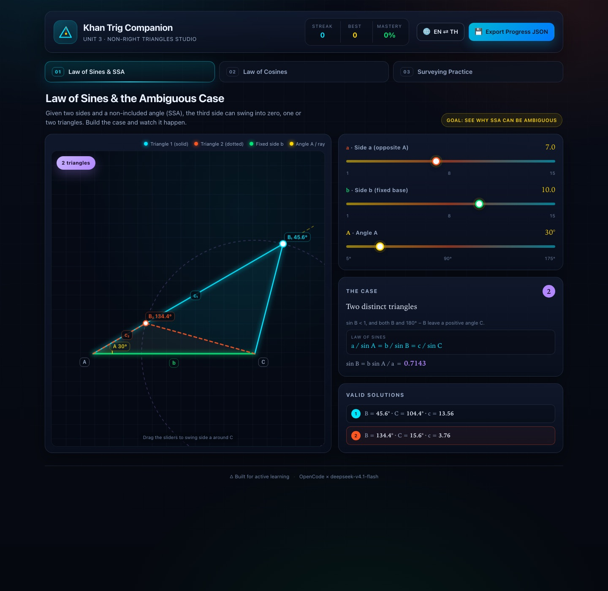

# Khan Trig Companion · Unit 3 Non-Right Triangles Studio

An interactive, bilingual companion for **Khan Academy Trigonometry, Unit 3: Non-Right Triangles & Geometry**. Students explore why SSA is ambiguous, solve SAS and SSS triangles with the Law of Cosines, and apply both laws to surveying and navigation problems — all in one offline HTML page with zero dependencies.

**Version 1.0.1** · [Live demo](https://somphol.github.io/khan-trig-unit3-non-right-triangles-studio/) · MIT · No build step



## The three studios

| # | Module | What it teaches |
|---|--------|-----------------|
| 01 | **Law of Sines & the Ambiguous Case** | Build an SSA triangle from sides `a`, `b` and angle `A`; the swinging side reveals zero, one or two valid triangles, drawn as solid cyan and dotted coral overlays. |
| 02 | **Law of Cosines · SAS & SSS Solver** | Solve a triangle from two sides and an included angle, or three sides, with a live algebraic substitution drawer and area readout. |
| 03 | **Surveying Practice** | Law of Sines, Law of Cosines and real-world lake, landmark, ship and drone problems with answer checking, animated map solutions, streaks and badges. |

## Features

- **Ambiguous-case proof, not a rule to memorise** — the canvas shows the ray from A, the circle of radius a around C, and both intersections when they exist.
- **Exact case detection** — `sin B > 1` yields no triangle; one valid candidate yields one; two positive angle-C candidates yield two.
- **Live algebra** — every Law of Cosines slider change rewrites the substitution, intermediate squares, square root and solved angles.
- **Real surveying** — lake baseline, landmark range, ship bearings and drone triangulation, each with a compass-enabled map grid.
- **Animated visual solutions** — steps appear one at a time while the map highlights the relevant side or angle, with a `Step n of m` marker.
- **Bilingual HUD (EN ⇄ TH)** — every label, prompt, feedback message and story problem switches language, including กฎของไซน์, กฎของโคไซน์ and กรณีสับสน (SSA).
- **Progress persistence** — streak, best streak, correct counts, mode and completed modules are saved to `localStorage`.
- **Export** — `💾 Export Progress JSON` downloads `khan_trig_unit3_progress.json`.
- **Accessibility** — labelled controls, keyboard tabs, visible focus rings, ARIA live feedback, reduced-motion support.
- **Offline and static** — no frameworks, CDN, fonts to download or network requests at runtime.

## Run locally

No install and no build step.

```bash
git clone https://github.com/somphol/khan-trig-unit3-non-right-triangles-studio.git
cd khan-trig-unit3-non-right-triangles-studio
python3 -m http.server 8080
```

Open <http://localhost:8080>. Opening `index.html` directly also works.

## Documentation

| Document | Purpose |
|----------|---------|
| [docs/ARCHITECTURE.md](docs/ARCHITECTURE.md) | State, SSA math, triangle constructors, solver, step animation, extension recipes |
| [docs/DESIGN.md](docs/DESIGN.md) | Pedagogy, colour matrix, Thai glossary, interaction decisions |
| [docs/TESTING.md](docs/TESTING.md) | Automated checks, verified matrix, manual regression list |
| [docs/DEPLOYMENT.md](docs/DEPLOYMENT.md) | GitHub Pages setup, verification, rollback, custom domain |
| [docs/ACCESSIBILITY.md](docs/ACCESSIBILITY.md) | WCAG target, implemented features, known gaps |
| [docs/RELEASE.md](docs/RELEASE.md) | Versioning, release checklist, hotfix and rollback |
| [CONTRIBUTING.md](CONTRIBUTING.md) | Ground rules, local setup, PR expectations |
| [CODE_OF_CONDUCT.md](CODE_OF_CONDUCT.md) | Contributor Covenant 2.1 |
| [SECURITY.md](SECURITY.md) | Supported versions, private reporting, scope |
| [SUPPORT.md](SUPPORT.md) | Common fixes and where to ask |
| [ROADMAP.md](ROADMAP.md) | Shipped work, candidates, non-goals |
| [CHANGELOG.md](CHANGELOG.md) | Release history |
| [state.json](state.json) | Build record: time, tokens and credits |
| [AGENTS.md](AGENTS.md) | Operating notes for the next developer or agent |

## Quality gates

```bash
node --check script.js      # JavaScript syntax
node scripts/check.mjs      # files, ids, tabs, i18n parity, colours, links, state
```

Both run in GitHub Actions on every push and pull request. The checker has no dependencies and verifies that the English and Thai dictionaries stay in sync, every referenced DOM id exists, three tabs and panels agree, local assets resolve, and runtime code contains no network APIs.

## How to use it

1. **Law of Sines** — drag the sliders. Watch the case badge, `sin B`, and the one or two solution rows. Try `a=3, b=10, A=30°` for no triangle, then `a=10, b=10, A=30°` for one.
2. **Law of Cosines** — choose SAS or SSS, drag the sliders, and read the substitution drawer below the canvas. In SSS, deliberately invalid sides trigger the triangle-inequality warning.
3. **Surveying Practice** — choose a mode, enter a numeric answer, check it, or reveal the animated map solution before trying a new problem.

## Project structure

```
index.html                 HUD, three panels, sliders, practice form and bilingual hooks
style.css                  Palette, layout, canvas cards, steps, badges and responsive rules
script.js                  State, i18n, SSA geometry, Law of Cosines solver, practice, export
scripts/check.mjs          Dependency-free static release checks
docs/                      Architecture, design, testing, deployment, a11y, release
.github/                   CI, issue templates, PR template, CODEOWNERS
state.json                 Build record: elapsed time, token usage, credits
AGENTS.md                  Operating notes for the next developer or agent
assets/hero.jpg            Documentation screenshot only
```

## Data and privacy

Everything stays in the browser. The only storage is `localStorage["khanTrigUnit3.v1"]` (language, settings, scores, badges). The export button creates a local Blob; nothing is uploaded. Clearing site data resets the studio.

## Verification

Tested in headless Chrome 156 on macOS with zero console errors: both SSA solutions, the zero- and one-triangle cases, SAS and SSS solving, the SSS triangle-inequality warning, all three practice modes, correct-answer scoring, animated step reveal, EN ⇄ TH switching, reload persistence, JSON export, and a 390 px mobile viewport with no horizontal overflow.

## Contributing

Issues and pull requests are welcome. Read [CONTRIBUTING.md](CONTRIBUTING.md) and keep the project static, offline and bilingual. Report vulnerabilities privately per [SECURITY.md](SECURITY.md).

## Credits

Built in a single session with **[OpenCode](https://opencode.ai)** running **DeepSeek V4.1 Flash** (`opencode-go/deepseek-v4.1-flash`). Exact elapsed time and token consumption are recorded in [`state.json`](state.json).

## Licence

MIT — see [LICENSE](LICENSE).
